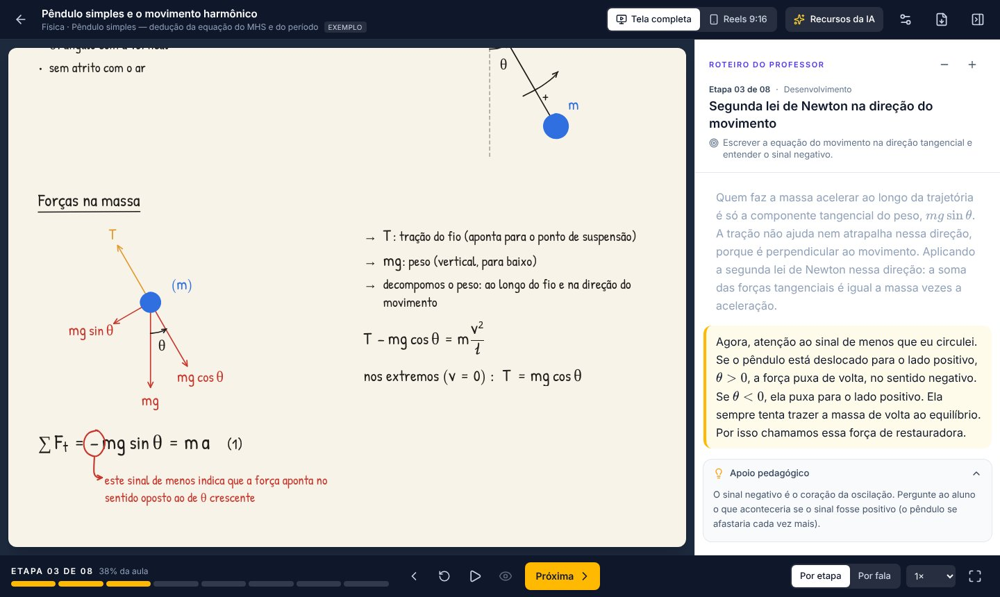
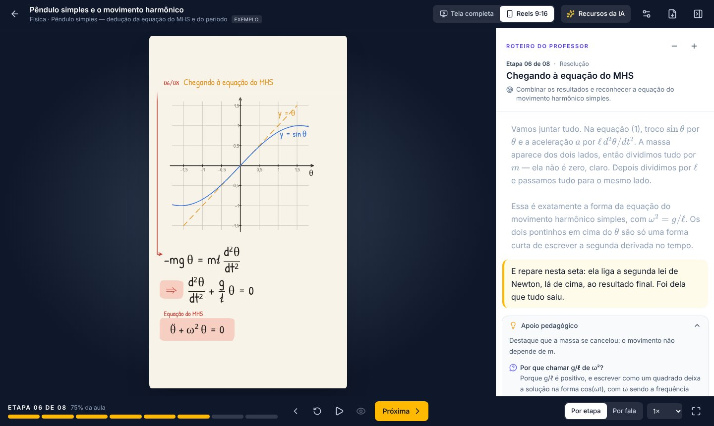

# Quadro Inteligente — plataforma de ensino com IA

Envie a foto de uma questão (Matemática, Física ou qualquer disciplina). A IA lê, resolve, **verifica** e transforma a resolução em uma **aula em etapas**: à esquerda, o quadro é escrito à mão na tela; à direita, o roteiro do que o professor deve falar, sincronizado trecho a trecho.

| Tela completa (16:9) | Reels (9:16) |
|---|---|
|  |  |

- **Especificação revisada do projeto:** [docs/ESPECIFICACAO.md](docs/ESPECIFICACAO.md)
- **Arquitetura e organização dos componentes:** [docs/ARQUITETURA.md](docs/ARQUITETURA.md)

## Principais recursos

- Upload por arrastar/soltar, seleção, colagem (Ctrl+V) ou câmera do celular; rotação e correção de orientação.
- **Fase A — análise e resolução:** transcrição, conceitos, fórmulas com origem e hipóteses, resolução passo a passo, verificação de cálculos e unidades, nível de confiança e **incertezas** que o professor confirma antes de gerar a aula (a IA não inventa dados).
- **Fase B — aula:** blocos pedagógicos dinâmicos, quadro + roteiro com sincronização por segmento de fala.
- **Quadro manuscrito animado:** equações surgindo símbolo a símbolo (KaTeX), traços, vetores, figuras, gráficos e tabelas desenhados à mão; círculos e anotações sobre partes de equações; marca-texto em resultados; conectores entre elementos.
- **Formatos:** tela completa ou **Reels 9:16 (1080×1920)** com áreas seguras, guias do Instagram, cabeçalho da etapa e assinatura.
- Navegação por etapa ou **por fala**, repetir, pausar, revelar tudo, velocidade, tela cheia, atalhos de teclado e passadores de slides.
- Temas papel / quadro branco / lousa; fórmulas manuscritas ou tipográficas.
- **Recursos da IA** sob demanda: explicar de outra forma, origem da fórmula, analogia, outra solução, exemplo adicional, exercícios semelhantes.
- Biblioteca de aulas, exportação em PDF e uma **aula de exemplo** (pêndulo simples) que funciona sem IA.

## Requisitos

- Node.js **22.13+** (usa o módulo nativo `node:sqlite`).
- Uma chave da API da Anthropic (Claude) para as funções de IA.

## Como executar

```bash
cd quadro-inteligente
npm install
cp .env.example server/.env      # e preencha ANTHROPIC_API_KEY
npm run dev                      # API em :8787 e interface em http://localhost:5173
```

Produção (um único processo servindo API e interface):

```bash
npm run build
npm start                        # http://127.0.0.1:8787
```

Variáveis em `server/.env` (veja `.env.example`): `ANTHROPIC_API_KEY`, `AI_MODEL` (padrão `claude-opus-5-5`), `AI_EFFORT_ANALYSIS`, `AI_EFFORT_LESSON`, `AI_EFFORT_ASSIST`, `AI_STRUCTURED_OUTPUTS`, `AI_SERVER_FALLBACK`, `PORT`, `HOST`, `DATA_DIR`.

Os dados (SQLite e imagens) ficam em `server/data/`.

## Atalhos na apresentação

| Tecla | Ação |
|---|---|
| → / PageDown / Enter | Próxima etapa (ou próxima fala no modo “Por fala”) |
| ← / PageUp | Etapa anterior |
| Espaço | Pausar / continuar |
| R | Repetir a etapa |
| A | Revelar tudo |
| F | Tela cheia |
| S | Mostrar/ocultar roteiro |

## Testes e verificação

```bash
npm run typecheck   # shared, server e web
npm test            # esquema, avaliador de expressões, validação e pipeline pedagógico
```

O teste do pipeline usa um provedor simulado apenas para verificar orquestração, validação, correção automática e persistência; a aplicação em si sempre usa a IA real.

## Trocar o provedor de IA

Implemente a interface `AIProvider` (`server/src/ai/provider.ts`) e registre-a em `server/src/ai/index.ts`. O motor pedagógico, as rotas e o frontend não mudam.

## Segurança

- A chave da API fica somente no servidor.
- Uploads validados pelo conteúdo real (sharp), com limite de tamanho; imagens normalizadas antes de irem para a IA.
- A IA nunca envia código: gráficos usam um avaliador de expressões próprio (sem `eval`) e o KaTeX só confia na macro de marcação `\qimark`.
- Limite de requisições nas rotas de IA, cabeçalhos de segurança e processamento exclusivo por aula.
